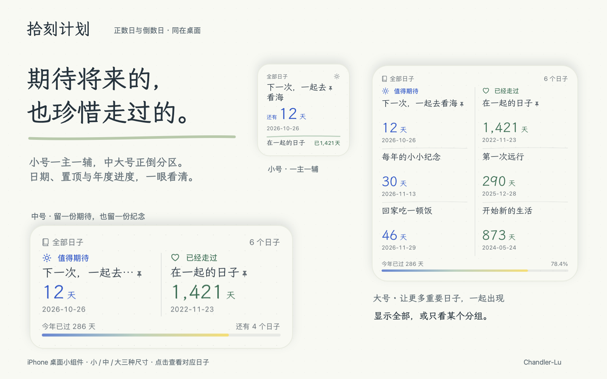

# 拾刻计划

**把零散安排，收进日历。把重要日子，放在心上。**

拾刻计划是一款手绘手帐风的 iPhone、iPad 与 Mac 日程和倒数日 App。贴一段文字、选一张截图，整理下一次见面；写下想做的事，慢慢把想法变成计划。

### 一句话，也能成为好好安排的一天

- **提取日程**：粘贴文字、导入照片、拍照或语音录入，识别名称、时间、地点与备注。图片文字由系统在设备上识别，再交给你选择的 AI 服务整理。
- **帮我安排**：还没有确定的时间也没关系。说出想做的事，通过几轮问答补充偏好，得到可修改的日程建议。
- **确认后再加入**：每一条都可以编辑；遇到模糊信息，引导你逐项核对。支持指定日历，也能按类别优选合适的日历。
- **看清接下来的几天**：当天、3 天、7 天日历视图；长按空白处新增，按住已有安排拖动调整时间。点一下“总结”，把当前安排整理成清晰的小结，复制为纯文本或 Markdown。
- **截图变日程**：用系统捷径“截屏 → 拾刻计划”，把当前页面交给原生文字识别，再核对提取出的安排。

### 把期待和纪念，写进日子

生日、旅行、相识的第一天，都值得被记住。倒数日支持公历与农历、分组与置顶、重复日期、秒级计时，也可以用自然语言一次添加多个日子。

单列卡片、双列卡片和紧凑列表随心切换；下拉找一个日子，再拉深一点就能新增。长按卡片可多选，一起移动分组或删除。年度进度彩条，让一年的脚步也看得见。

为满周年、每 100／500／1000 天，或特别的 520、1314 天设下提醒。也可以自定义间隔、选择包含起始日，把重要时刻做成竖版卡片分享。21 张兔兔和猫咪的彩铅手绘插画，挑一张喜欢的，让纪念更有温度。

### 桌面一瞥，抬腕可见

iPhone、iPad 和 Mac 桌面小组件提供小、中、大三种尺寸：小号一主一辅，中、大号分区展示「值得期待」的倒数日和「已经走过」的正数日，配上日期与年度进度彩条。Apple Watch 可以查看日子列表与详情，也能添加到智能叠放。

锁屏也能一眼看见：行内、圆形和矩形三种小组件，展示还有多久、已经多久，点击直达对应日子。

选择「全部日子」，只显示某个分组，或为小组件固定一到两个特别的日子。小号与锁屏优先呈现你选择的第一个日子，中号与大号让两个日子同样醒目。将两个选择都设为「留空」，即可恢复自动展示。小组件与手表各自记住你的选择；手表接收配对 iPhone 的更新，离线时仍能查看已同步的日子。

### 小屏随手记，大屏展开写

在 iPhone 上随手记下安排，在 iPad 和 Mac 上展开手帐。宽屏侧边栏让日历、倒数日和记录触手可及；原文与整理结果并排核对，日子与记录可以一边翻看、一边编辑。旋转 iPad 或调整窗口大小，继续写刚才的内容。

Mac 支持选择或拖入图片、纯文本文件，也能从系统分享菜单接收素材。用 ⌘1–5 切换页面，⌘N 新建，⌘O 导入文件，⌘⇧V 导入剪贴板，⌘F 搜索，⌘, 打开设置。

### 记下的，也好好留住

iCloud 可同步倒数日、分组、接口配置与使用偏好。自动备份同时保留本地与 iCloud Drive 副本，每台设备保留最近 30 份；在数据变化、打开或离开 App 时检查备份。

支持导出和恢复拾刻计划 JSON 备份。导入前先预览、自动保存一份当前数据，再合并新内容；已有记录保留，历史日程不会自动重复加入系统日历。

### 用你习惯的 AI，按你的方式安排

支持保存多个接口、获取模型列表或手动填写模型，兼容 OpenAI、Claude 和 Gemini 格式，自定义服务地址。提取日程与帮我安排各有一套可编辑的提示词。

提取与安排首次向模型服务发送内容前会说明范围并征求同意；日历总结由你点击发起，使用当前显示日程的标题、时间与地点。API Key 由系统钥匙串保管，不写入 JSON 备份。拾刻计划不设开发者数据服务器，也不接入广告追踪。

### 从这里开始

1. 在设置中添加你使用的模型接口。
2. 粘贴一段安排，选择「提取日程」；或者写下目标，选择「帮我安排」。
3. 核对、修改，加入你选定的日历。

手动管理倒数日、查看小组件与手表不需要调用 AI。AI 功能需自备可用接口，相关费用由所选服务商决定。

适用于 **iOS / iPadOS 17 及以上、macOS 14 及以上**；Apple Watch 需 **watchOS 10 及以上**，并配对安装拾刻计划的 iPhone。

[帮助与支持](https://github.com/Chandler-Lu/shike/issues) · [隐私政策](https://github.com/Chandler-Lu/shike/blob/main/PRIVACY.md) · [反馈邮箱](mailto:shike@yeslu.cn) · [作者 Chandler-Lu](https://www.yeslu.cn)
