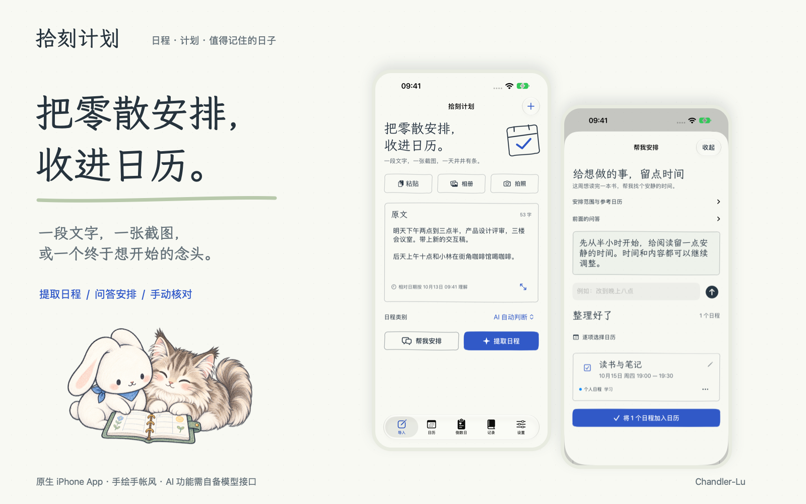
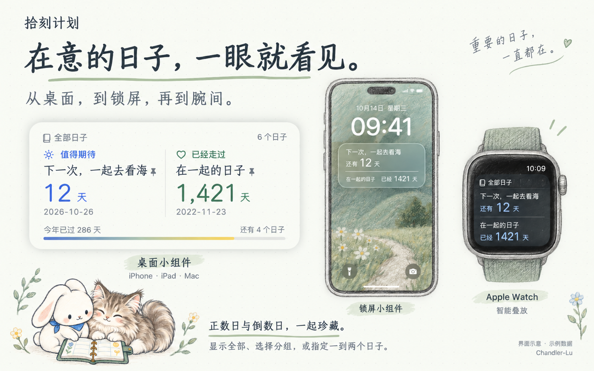
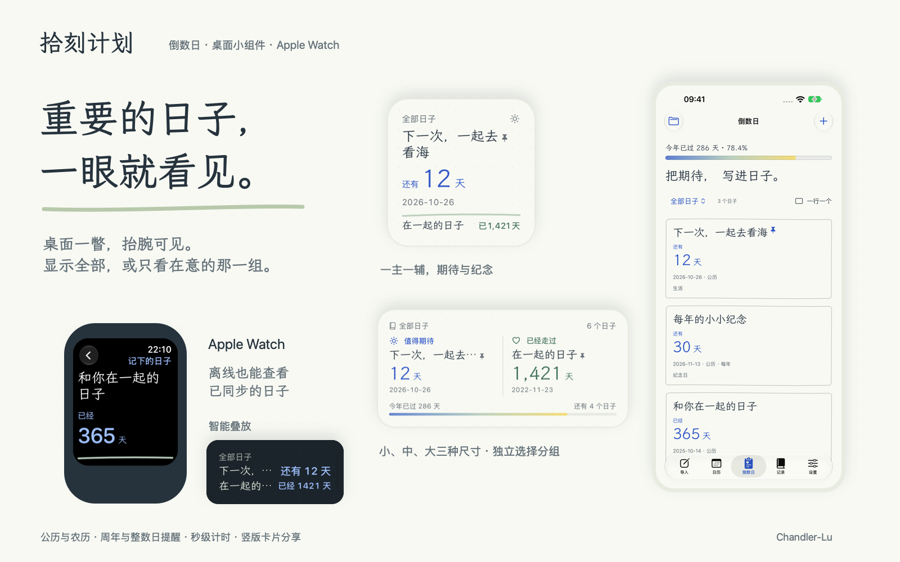
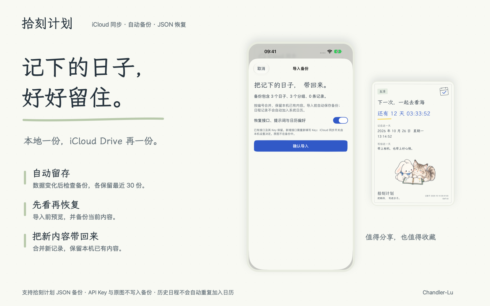

# 拾刻计划

**把零散安排，收进日历。把重要日子，放在心上。**

拾刻计划是一款手绘手帐风的日程和倒数日 App。在 **iPhone** 随手记录，在 **iPad、Mac** 展开安排，把重要日子放上**桌面与锁屏小组件**，也带到 **Apple Watch** 的腕间。

贴一段文字、选一张截图，整理下一次见面；写下想做的事，慢慢把想法变成计划。期待中的旅行、已经走过的纪念日，都有自己的位置。

### 从手机到电脑，找到舒服的记录方式

同样的纸张底色、手写字和兔兔猫咪，在不同屏幕上展开不同的空间。

| 设备 | 适合你的使用方式 |
| --- | --- |
| **iPhone** | 随手粘贴、拍照、语音输入；查看当天安排，把重要日子放在主屏幕与锁屏上。 |
| **iPad** | 横竖屏自适应，宽屏下并排核对原文与结果；通过侧边栏切换日历、倒数日和记录。 |
| **Mac** | 大窗口整理计划，拖入图片与文本，用键盘快捷键切换页面、导入素材；桌面小组件随时提醒期待。 |
| **Apple Watch** | 抬腕查看正数日、倒数日及详情，按分组筛选，把重要日子加入智能叠放。 |

旋转 iPad 或调整 Mac 窗口，布局随之展开或收拢。Mac 支持 ⌘1–5 切换页面、⌘N 新建、⌘O 导入文件、⌘⇧V 导入剪贴板、⌘F 搜索、⌘, 打开设置。

开启 iCloud 后，倒数日、分组、接口配置与使用偏好可在设备之间同步。Apple Watch 从配对的 iPhone 接收日子，离线时也能查看已同步的内容。

### 重要的日子，不打开 App 也看得见

还有多久出发，已经相伴多少天。**正数日与倒数日都能放进小组件**，让期待与纪念出现在每天都会看到的地方。

| 展示位置 | 小组件体验 |
| --- | --- |
| **iPhone、iPad 主屏幕与 Mac 桌面** | 小、中、大三种尺寸，延续手绘风格，配上日期与年度进度彩条。小号突出一个日子，也可附带第二个；中、大号提供更充裕的展示空间。 |
| **iPhone 锁屏** | 行内、圆形、矩形三种样式，抬起手机就能查看计数，点击直达对应日子。 |
| **Apple Watch 智能叠放** | 在腕间查看日子，点击进入手表 App 了解详情。 |

**每个小组件，都可以有自己的关注点。** 展示全部日子、只看一个分组，或固定一到两个特别的日子，例如下一次旅行与相识纪念日。

指定两个日子时，小号与锁屏优先显示你选的第一个，支持的位置附带第二个；中号与大号让两个日子同样醒目。两个选择都设为「留空」，即可恢复按分组自动展示。自动展示时，中、大号会把「值得期待」与「已经走过」分区呈现。

### 一句话，也能成为好好安排的一天

- **提取日程**：粘贴文字、导入照片、拍照或语音录入，识别名称、时间、地点与备注。图片文字由系统在设备上识别，再交给你选择的 AI 服务整理。
- **帮我安排**：还没有确定的时间也没关系。说出想做的事，通过几轮问答补充偏好，得到可修改的日程建议。
- **确认后再加入**：每一条都可以编辑；遇到模糊信息，引导你逐项核对。支持指定日历，也能按类别优选合适的日历。
- **看清接下来的几天**：当天、3 天、7 天日历视图；长按空白处新增，按住已有安排拖动调整时间。点一下“总结”，把当前安排整理成清晰的小结，复制为纯文本或 Markdown。
- **截图变日程**：用系统捷径“截屏 → 拾刻计划”，把当前页面交给原生文字识别，再核对提取出的安排。

### 把期待和纪念，写进日子

生日、旅行、相识的第一天，都值得被记住。倒数日支持公历与农历、分组与置顶、重复日期、秒级计时，也可以用自然语言一次添加多个日子。

单列卡片、双列卡片和紧凑列表随心切换；下拉找一个日子，再拉深一点就能新增。长按卡片可多选，一起移动分组或删除。年度进度彩条，让一年的脚步也看得见。

为满周年、每 100／500／1000 天，或特别的 520、1314 天设下提醒。也可以自定义间隔、选择包含起始日。

点详情中的计数，可切换天、周、月、年，分列看清每一段时间；退出详情后恢复按天显示。分享卡片沿用当前计数方式，搭配 21 张可选的兔兔和猫咪彩铅手绘插画，把重要时刻做成一张竖版纪念卡。

### 记下的，也好好留住

iCloud 可同步倒数日、分组、接口配置与使用偏好。自动备份同时保留本地与 iCloud Drive 副本；在数据变化、打开或离开 App 时检查备份。

支持导出和恢复拾刻计划 JSON 备份。导入前先预览、自动保存一份当前数据，再合并新内容；已有记录保留，历史日程不会自动重复加入系统日历。

### 用你习惯的 AI，按你的方式安排

支持保存多个接口、获取模型列表或手动填写模型，兼容 OpenAI、Claude 和 Gemini 格式，自定义服务地址。提取日程与帮我安排各有一套可编辑的提示词。

提取、安排与总结时，可以先去做别的事。系统允许时，切到后台或锁屏仍会继续处理；结果保存后发送完成通知，也可在「设置 → 模型任务与结果」中查看。

提取与安排首次向模型服务发送内容前会说明范围并征求同意；日历总结由你点击发起，使用当前显示日程的标题、时间与地点。API Key 由系统钥匙串保管，不写入 JSON 备份。拾刻计划不设开发者数据服务器，也不接入广告追踪。

### 从这里开始

1. 在设置中添加你使用的模型接口。
2. 粘贴一段安排，选择「提取日程」；或者写下目标，选择「帮我安排」。
3. 核对、修改，加入你选定的日历。

手动管理倒数日、查看小组件与手表不需要调用 AI。AI 功能需自备可用接口，相关费用由所选服务商决定。

适用于 **iOS / iPadOS 17 及以上、macOS 14 及以上**；Apple Watch 需 **watchOS 10 及以上**，并配对安装拾刻计划的 iPhone。

[帮助与支持](https://github.com/Chandler-Lu/shike/issues) · [隐私政策](https://github.com/Chandler-Lu/shike/blob/main/PRIVACY.md) · [反馈邮箱](mailto:shike@yeslu.cn) · [作者 Chandler-Lu](https://www.yeslu.cn)
