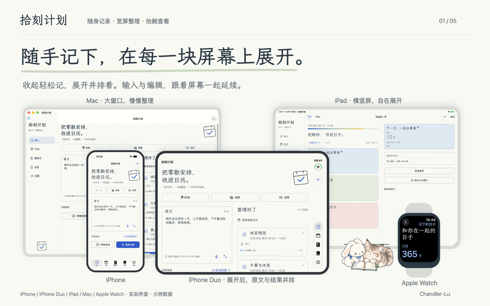
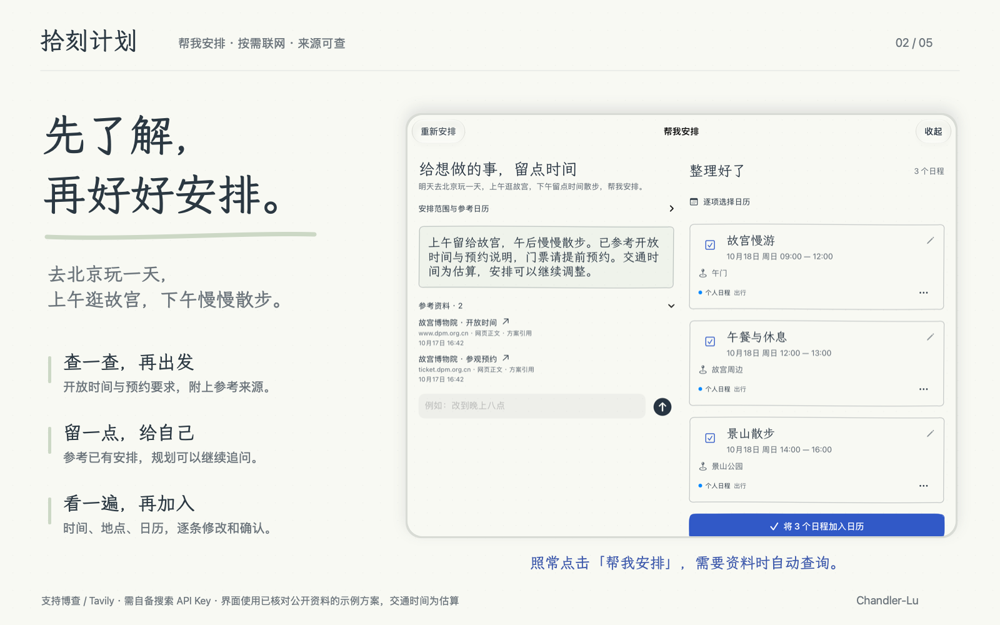
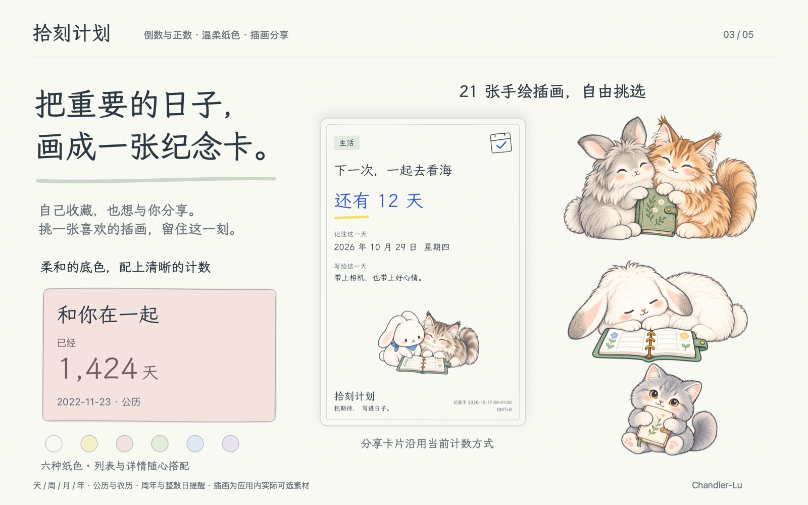
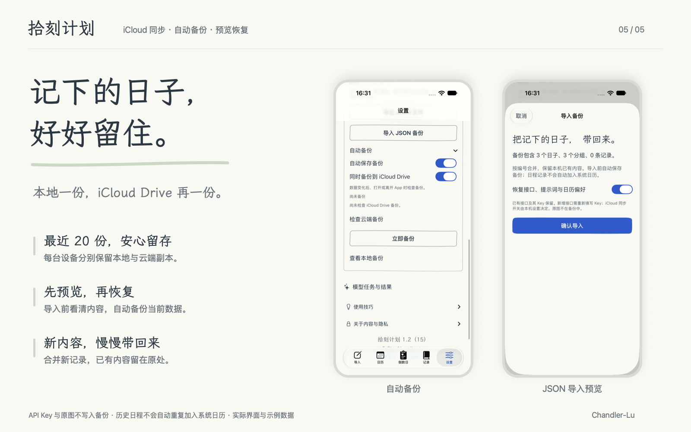

# 拾刻计划 · 产品宣传图

五张手绘纸张风格的产品宣传图，适合项目主页、产品介绍与分享。以五设备产品图为首图；第 04 张为 **1586 × 992**，其余四张为 **1600 × 1000**。

| 图片 | 展示内容 |
| --- | --- |
| [01 · 随手记下，在每一块屏幕上展开](01-platforms.png) | iPhone、展开的 iPhone Duo、iPad、Mac 与 Apple Watch；宽屏并排整理 |
| [02 · 先了解，再好好安排](02-online-planning.png) | 联网规划北京一日游；参考开放时间、预约说明，核对后加入日历 |
| [03 · 把重要的日子，画成一张纪念卡](03-countdowns.png) | 一张代表色卡、六种圆点色样、竖版分享卡片与部分可选插画 |
| [04 · 在意的日子，一眼就看见](04-widgets.png) | 彩铅手绘桌面、锁屏、智能叠放场景；按全部、分组或指定一两个日子显示 |
| [05 · 记下的日子，好好留住](05-backup.png) | 本地与 iCloud Drive 各保留最近 20 份备份；导入预览与合并恢复 |

第 01、02、03、05 张使用当前应用截图、原生视图渲染与应用内插画；第 04 张为参考当前小组件内容重绘的彩铅场景示意。第 03 张“和你在一起”使用作者指定的真实起始日 2022-11-23，其余内容为示例，设备外框用于展示。联网规划使用已核对资料的示例方案，不代表实时查询或已完成预约。

[原始素材](assets/) · [素材来源与复现](SOURCES.md) · [返回产品介绍](../README.md)
